<div align="center">

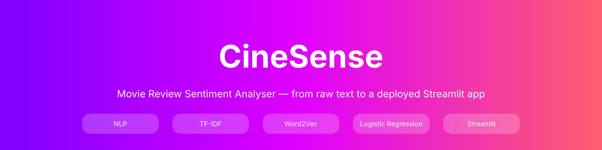

# 🎬 CineSense — Review Analytics from Raw Text to Streamlit App

**NLP Practical Exam · Set A ·**

[](https://cinesense-review-analytics-for-an-ottplatform.streamlit.app/)
[](YOUR_VIDEO_LINK)


**[🌐 Try the App](https://cinesense-review-analytics-for-an-ottplatform.streamlit.app/)** ·
**[📓 Notebook](NLP_Practical_Exam_SetA.ipynb)** ·
**[📝 Summary Report](summary_report.md)** ·
**[🎥 Video](YOUR_VIDEO_LINK)**

</div>

---

## 📑 Table of Contents

- [Project Overview](#-project-overview)
- [Live Demo](#-live-demo)
- [Pipeline](#-pipeline)
- [Steps Covered](#-steps-covered)
- [Datasets](#-datasets)
- [Results Summary](#-results-summary)
- [Visual Results](#-visual-results)
- [Repository Structure](#-repository-structure)
- [Installation](#-installation)
- [How to Run](#-how-to-run)
- [Video](#-video)
- [Reflection & Next Steps](#-reflection--next-steps)
- [Author](#-author)

---

## 🎯 Project Overview

I played the role of a **Junior NLP Engineer** on the content-analytics team of an Indian OTT streaming platform (think JioCinema / Hotstar). Thousands of viewers post text reviews every day and nobody can read them all by hand.

This project builds a small, working system that **cleans raw text → converts it to numbers → learns from it → tells the team whether a review is positive or negative**, all wrapped in a web app anyone can use.

| | |
|---|---|
| **Business problem** | Automatically classify viewer reviews as Positive / Negative |
| **Best model** | TF-IDF + Logistic Regression (**86.5 % accuracy**) |
| **Deployed as** | Streamlit web app (**CineSense**) |
| **Duration** | 6-hour practical exam |

---

## 🚀 Live Demo

> 🔗 **App URL:** https://cinesense-review-analytics-for-an-ottplatform.streamlit.app/

Paste a movie review → click **Analyse Sentiment** → get the label, confidence, the top 3 influential words and the POS tags of your text.

| 😊 Clearly Positive | 😞 Clearly Negative | 🤔 Tricky (Negation) |
|:---:|:---:|:---:|
|  |  |  |

**App features**

- ✅ Title + one-line description, text area, **Analyse** button
- ✅ Result as **Positive 😊 / Negative 😞** with confidence % from `predict_proba`
- ✅ Sidebar with **3 example reviews** (one-click load) and an **About** note
- ✅ Empty input handled with `st.warning('Please enter a review')`
- ⭐ Bonus: **top 3 words** that pushed the prediction (TF-IDF × coefficient)
- ⭐ Bonus: **POS-tag expander** for the entered review
- ⭐ Extra: view of the cleaned text the model actually received

---

## 🧭 Pipeline

<div align="center">
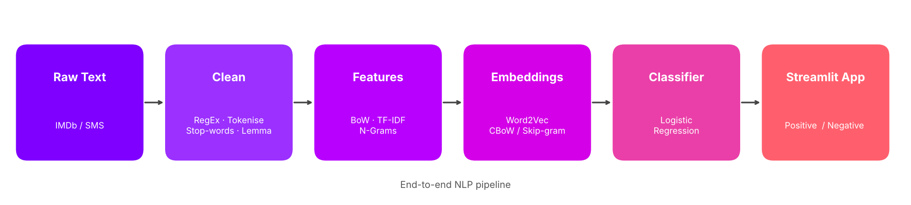
</div>

---

## 🧩 Steps Covered

| Step | Topic | Highlights |
|:---:|---|---|
| **1** | NLP Fundamentals, Preprocessing & RegEx | Theory notes, EDA, URL / phone / currency RegEx, `clean_text()`, Porter vs WordNet, word frequency |
| **2** | Feature Extraction | BoW, TF-IDF and N-Grams on a tiny corpus and on SMS data, sparsity table |
| **3** | Word Embeddings | Word2Vec **CBoW vs Skip-gram**, similar words, PCA visualisation |
| **4** | Text Classification | 4 classifiers (BoW, TF-IDF, TF-IDF+N-Grams, avg. Word2Vec), metrics, confusion matrix, saved pipeline |
| **5** | Approaches & POS Tagging | Heuristic vs VADER vs ML, POS tags, top adjectives per class |
| **6** | Streamlit App | `app.py`, local tests, deployment on Streamlit Community Cloud |
| **7** | Comparison, Reflection & GitHub | Results table, written reflection, summary report, this repo |

---

## 📚 Datasets

| Used in | Dataset | Size | Link |
|---|---|---|---|
| Steps 1 – 2 | SMS Spam Collection (`spam.csv`) | 5,572 messages (4,825 ham / 747 spam) | [UCI](https://archive.ics.uci.edu/dataset/228/sms+spam+collection) · [Kaggle](https://www.kaggle.com/datasets/uciml/sms-spam-collection-dataset) |
| Steps 3 – 6 | IMDb Dataset of 50K Movie Reviews | 50,000 reviews → **balanced 5,000 sample** (2,500 pos / 2,500 neg, `random_state=42`) | [Kaggle](https://www.kaggle.com/datasets/lakshmi25npathi/imdb-dataset-of-50k-movie-reviews) |

---

## 📊 Results Summary

### Step-wise summary

| Step / Topic | Dataset Used | Key Technique | Key Result | Time |
|---|---|---|---|:---:|
| 1 · RegEx & Preprocessing | SMS Spam (5,572) | `re`, NLTK, WordNet lemmatizer | 13.41 % spam; 105 of 107 URL messages are spam; 93.45 % of £/$ messages are spam | ~40 min |
| 2 · BoW / TF-IDF / N-Grams | SMS Spam | `CountVectorizer`, `TfidfVectorizer` | 3000 features each, 99.76 % sparsity | ~35 min |
| 3 · Word2Vec | IMDb (5,000) | Gensim CBoW & Skip-gram | Vocabulary of 10,883 words, 100-dim vectors, 117.89 tokens / review | ~45 min |
| 4 · Classification | IMDb (5,000) | Logistic Regression + 4 feature types | **TF-IDF 86.5 %** accuracy | ~60 min |
| 5 · Approaches & POS | 1,000 test reviews | Heuristic, VADER, ML, `pos_tag` | ML 86.5 % vs heuristic 69.1 % vs VADER 66.0 % | ~45 min |
| 6 · Streamlit | `sentiment_pipeline.pkl` | Streamlit + joblib | Live web app deployed | ~30 min |

### Step 4 — Four classifiers (test set, 1,000 reviews)

| Rank | Model | Accuracy | Precision | Recall | F1-Score |
|:---:|---|:---:|:---:|:---:|:---:|
| 🥇 | **TF-IDF + N-Grams (1,2)** | 0.8650 | 0.8463 | 0.8920 | **0.8685** |
| 🥈 | **TF-IDF** *(saved & deployed)* | 0.8650 | 0.8503 | 0.8860 | 0.8678 |
| 🥉 | Averaged Word2Vec | 0.8350 | 0.8317 | 0.8400 | 0.8358 |
| 4 | Bag-of-Words | 0.8360 | 0.8373 | 0.8340 | 0.8357 |

### Step 5 — Three approaches (same 1,000 reviews)

| Approach | Needs training data? | Accuracy | Advantage | Disadvantage |
|---|:---:|:---:|---|---|
| Heuristic (rule-based) | No | 0.691 | Simple and fast | Cannot understand context |
| Ready-made tool (VADER) | No | 0.660 | No training required | Less accurate on long movie reviews |
| **Machine Learning** | **Yes** | **0.865** | Learns from labelled data | Needs data and training |

### Most influential words (TF-IDF + Logistic Regression)

| 🟢 Positive | Coef. | 🔴 Negative | Coef. |
|---|:---:|---|:---:|
| great | +4.21 | bad | −4.76 |
| excellent | +2.87 | worst | −3.82 |
| best | +2.75 | waste | −3.15 |
| perfect | +2.64 | poor | −2.95 |
| love | +2.53 | awful | −2.70 |

---

## 🖼️ Visual Results

<details open>
<summary><b>Step 1 — SMS Spam exploration</b></summary>
<br>

| Ham vs Spam | Message length |
|:---:|:---:|
| 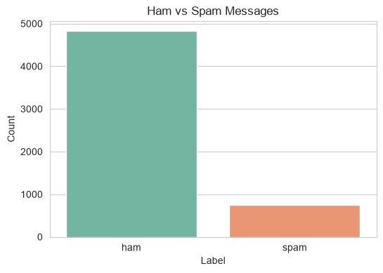 | 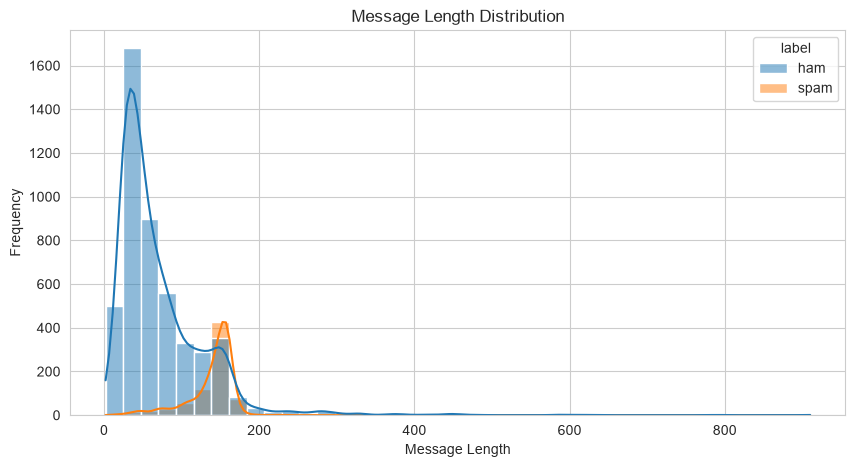 |

| Top spam words | Top ham words |
|:---:|:---:|
| 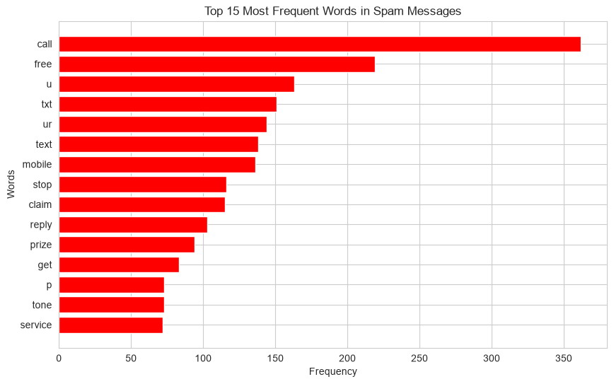 | 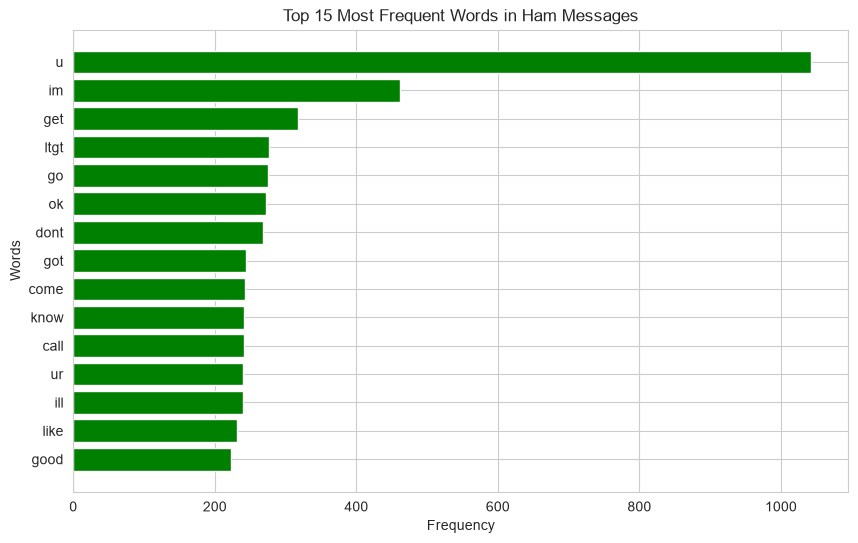 |

</details>

<details open>
<summary><b>Step 3 — Word2Vec (Skip-gram) PCA</b></summary>
<br>

<div align="center">
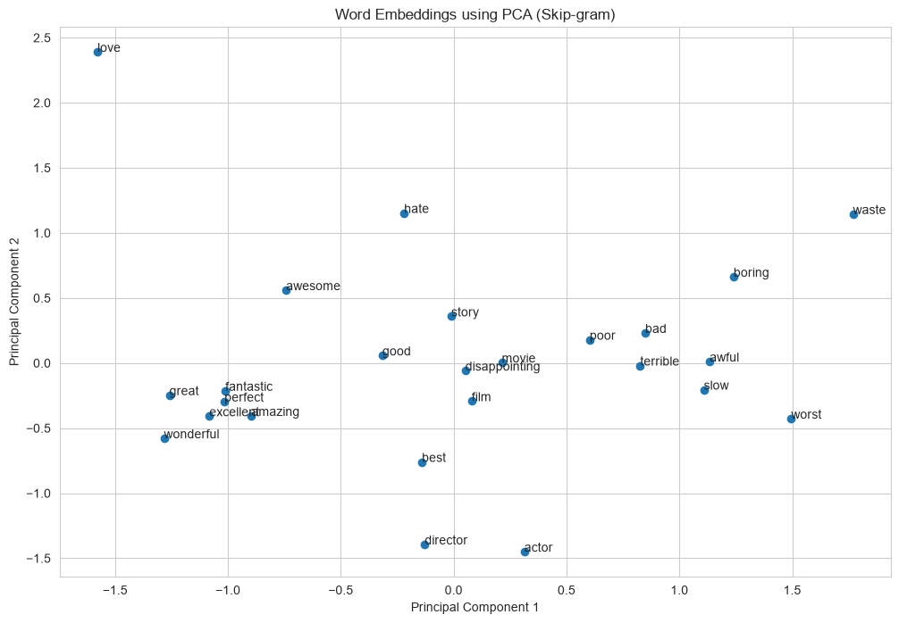
</div>

</details>

<details open>
<summary><b>Step 4 — Model comparison</b></summary>
<br>

| Accuracy of 4 models | Confusion matrix (best model) |
|:---:|:---:|
| 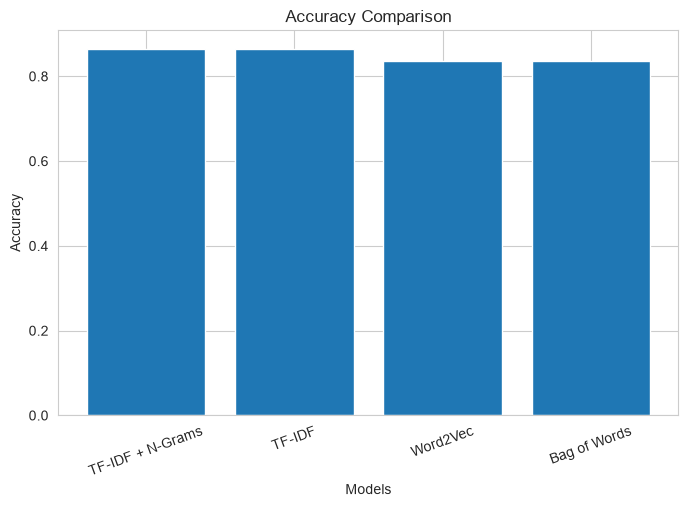 | 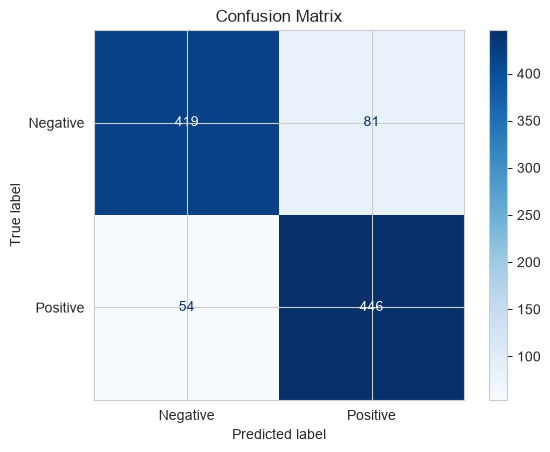 |

</details>

<details open>
<summary><b>Step 5 — Approaches & POS adjectives</b></summary>
<br>

<div align="center">
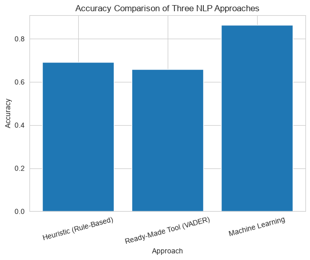
</div>

| Top positive adjectives | Top negative adjectives |
|:---:|:---:|
| 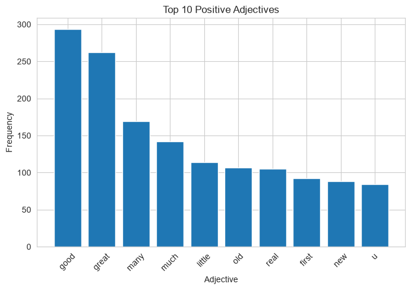 | 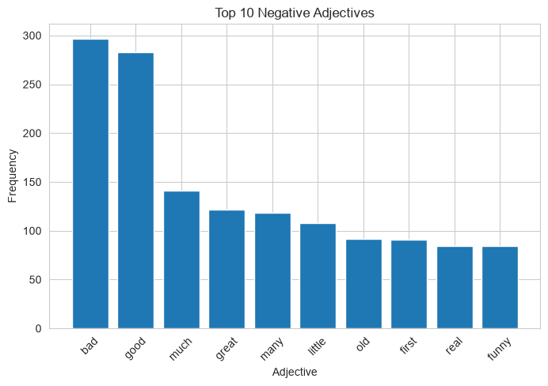 |

</details>

---

## 🗂️ Repository Structure

```text
nlp-practical-exam-set-a/
├── 📓 NLP_Practical_Exam_SetA.ipynb   # Steps 1–5 (fully executed) + Step 7 reflection
├── 🚀 app.py                          # Streamlit app (CineSense)
├── 🧠 sentiment_pipeline.pkl          # Saved TF-IDF + Logistic Regression pipeline
├── 🧬 word2vec_skipgram.model         # Saved Skip-gram model (+ .npy files if any)
├── 📦 requirements.txt                # Pinned dependencies
├── 📝 summary_report.md               # ~1-page results & reflection
├── 📖 README.md                       # You are here
└── 🖼️ outputs/                        # Plots + Streamlit screenshots
    ├── banner.png
    ├── pipeline.png
    ├── 01_…10_*.png                   # Notebook plots
    └── streamlit_positive.png · streamlit_negative.png · streamlit_tricky.png
```

---

## ⚙️ Installation

```bash
# 1. Clone the repository
git clone https://github.com/YOUR_USERNAME/nlp-practical-exam-set-a.git
cd nlp-practical-exam-set-a

# 2. (Optional) create a virtual environment
python -m venv venv
source venv/bin/activate        # Windows: venv\Scripts\activate

# 3. Install dependencies
pip install -r requirements.txt
```

> ⚠️ **Version note:** the `.pkl` was saved with `scikit-learn==1.8.0`. Use the same version to avoid unpickling errors.

NLTK data is downloaded automatically by the app. For the notebook, run once:

```python
import nltk
for pkg in ["punkt", "punkt_tab", "stopwords", "wordnet", "omw-1.4",
            "averaged_perceptron_tagger", "averaged_perceptron_tagger_eng",
            "vader_lexicon"]:
    nltk.download(pkg)
```

---

## ▶️ How to Run

**Notebook**

```bash
jupyter notebook NLP_Practical_Exam_SetA.ipynb
```

Place `spam.csv` and `IMDB Dataset.csv` where the notebook expects them (update the paths in the loading cells) and run **Kernel → Restart & Run All**.

**Streamlit app**

```bash
streamlit run app.py
```

Then open http://localhost:8501.

---

## 🎥 Video

[](YOUR_VIDEO_LINK)

> 🎬 `Practical_Exam_YourName_GRID.mp4` — face + screen walkthrough of every NLP technique, results and the app demo.

---

## 💭 Reflection & Next Steps

- **Hardest step:** Step 4 — building, evaluating and comparing several models, then picking the best one.
- **Best feature method:** TF-IDF (with or without N-Grams) reached 86.5 %. Word2Vec trailed because 5,000 reviews are too few to learn strong embeddings.
- **BoW fails, N-Grams succeed:** *"The movie is not good."* BoW sees `not` and `good` separately; the bigram `not good` keeps the negation.
- **Word2Vec's edge:** it places *great* and *excellent* close together, while BoW / TF-IDF treat them as unrelated columns.
- **Heuristic vs ML:** the rule-based method (69.1 %) is fast and needs no data, but misses negation and sarcasm; ML (86.5 %) learns from labelled examples.
- **Hinglish limitation:** a review like *"picture timepass thi"* will likely be misclassified because the model only knows English movie reviews.
- **Next steps:** more data, better cleaning (keep negations like *not*), multilingual support, and fine-tuning a Hugging Face Transformer such as BERT / DistilBERT.

---

## 👤 Author

**Krisha Anghan**
NLP Practical Exam (Set A) · Red & White Skill Education

[](https://github.com/YOUR_USERNAME)

<div align="center">

⭐ If you found this project helpful, give the repo a star!

</div>
